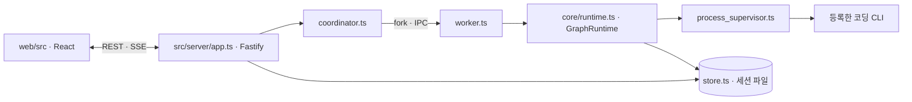

# 실행 구조

2026-10-30 기준. 사용자 기능과 조건은 [README](../README.md), [실행 조건](EXECUTION_CONDITIONS.md), [자율 실행](AUTONOMOUS_WORKFLOW.md)을 기준으로 한다. 이 문서는 코드를 수정하는 사람을 위한 내부 구조다.

## 프로세스

세션마다 워커 프로세스 하나가 `GraphRuntime.run()`을 실행한다. 워커는 `owner.lock`/`lease.json`으로 세션을 소유하고, Stop·Interrupt는 파일 제어 큐(`resilience.ts`)로 전달된다. 상태는 저장할 때마다 `revision`이 증가하고 IPC로 서버에 전달된다.

## 방문 실행 (`GraphRuntime.execute`)

`run()`은 현재 노드의 방문을 고르고 `execute(node, visit)`를 호출한다. 반환값이 `Completion`이면 성공·실패 간선으로 이동하고, `null`이면 세션이 이미 정지(또는 제어 요청 처리)된 것이다.

| 단계 | 메서드 | 내용 |
| --- | --- | --- |
| 1 | `preflight` | CLI 호출 없이 판정되는 게이트: 검토·승인의 테스트 소스 snapshot, 검증 계약 잠금, runner, 필수 파일, 자동화 테스트 역할의 소스 해시 |
| 2 | `stage` | 바인딩·연결·`runPolicy`·마감·attempt 한도를 고정한 `Stage` |
| 3 | `attemptGuards` | 매 호출 전 제어 요청, 계약 변조, 세션·단계 예산 |
| 4 | `invocationOptions` → `buildInvocation` | 프롬프트와 CLI별 인자·환경 |
| 5 | `newAttempt` | attempt 기록 생성·저장 |
| 6 | `supervise` | `ProcessSupervisor` 실행. 가드 콜백이 `AttemptRun.policyReason`/`sourceChanges`에 기록 |
| 7 | `recordOutcome` | 증거(명령 receipt, 읽은 파일, 감사, 파일 변경)를 attempt·방문에 반영 |
| 8 | `evidenceGates` | 고아 프로세스, VM·범위 감사, 고정 테스트의 소스 변경, 예산, 보호 파일, 단계 예산, 해시 비교, 승인 전 소스 재검사 |
| 9 | `judge` | 자체 Node 증명, `validateCompletion`, 필수 파일, 자율 계획의 외부 경로, 환경 차단 |
| 10 | `failure` + 재시도 | 실패 분류, 비재시도·할당량 정지, 재시도·재접속·완료 복구 |

`evidenceGates`와 `judge`는 `undefined`이면 다음 단계로 진행한다.

## 정지 경로

정지는 `halt(visit, status, reason, { pauseVisit, clearRecovery })`로 하며 부수효과를 호출부에서 명시한다. 같은 상태라도 경로마다 다르므로 통일하지 않는다.

| 경로 | 상태 | 방문 pause | 예약 복구 취소 |
| --- | --- | --- | --- |
| 테스트 전 소스 읽기 실패 | WAITING_USER | ✅ | ❌ |
| 실행 어댑터 사용 불가 (`IO_UNAVAILABLE`) | BLOCKED | ✅ | ❌ |
| 고아 프로세스 (supervisor) | BLOCKED | ✅ | ❌ |
| VM 실행 증거 불완전 | BLOCKED | ✅ | ✅ |
| 대상 밖 native 조회 | BLOCKED | ✅ | ✅ |
| 보호 검증 파일 쓰기 | BLOCKED | ✅ | ✅ |
| 고정 테스트의 환경 제약 | WAITING_USER | ✅ | ✅ |
| 고정 테스트의 인증·권한·모델 오류 | WAITING_USER | ✅ | ❌ |
| 완료 응답의 환경 차단 | WAITING_USER | ✅ | ✅ |
| 비재시도 실패 | WAITING_USER | ✅ | ❌ |
| 유료·미확인 모델의 할당량 소진 | PAUSED | ✅ | ❌ |
| 분류상 고아 프로세스 (도달하지 않음) | BLOCKED | ❌ | ❌ |

예산(`budgetStop`), 단계 예산(`stageStop`), 계약 변조(`contractStop`), 소진(`exhausted`)은 별도 메서드가 처리한다. `run()` 시작 시 예약 복구는 이미 비워지므로 "취소 ❌"는 실행 중 새로 예약된 복구가 없다는 뜻이다.

## 실행 정책 (`run_policy.ts`)

그래프의 `automation` 플래그와 노드에 연결된 CLI 종류로 정해지는 결정이다. 편집기와 그래프 검증은 원래 플래그를 그대로 사용한다.

| 결정 | 조건 |
| --- | --- |
| `localHttpAccess` | Codex + `browserVerification` |
| `kiloScopeGuard` | Kilo + `targetScopeGuard` |
| `kiloProgramIo` | Kilo + `programIoGuard` |
| 나머지 | 같은 이름의 그래프 플래그 |

## 동작 고정 테스트

| 테스트 | 고정 대상 |
| --- | --- |
| `prompt_golden.test.ts` | 역할·자동화 조합별 노드 프롬프트와 복구 메시지 전문 |
| `invocation_golden.test.ts` | CLI·역할·옵션별 인자, 앱이 바꾼 환경 변수, transport (`win32`/`posix`) |
| `runtime_characterization.test.ts` | 기존 시나리오가 닿지 않던 정지 경로의 전체 세션 상태 |
| `run_policy.test.ts`, `isolation.test.ts` | 플래그·CLI 조합 결정과 격리 안내 |

V8 커버리지는 워커 프로세스 코드를 적게 집계한다. 경로 도달 여부는 빌드 산출물에 probe를 넣어 확인한다.
