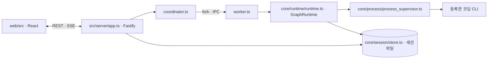

# 실행 구조

2026-11-03 기준. 사용자 기능과 조건은 [README](../README.md), [실행 조건](EXECUTION_CONDITIONS.md), [자율 실행](AUTONOMOUS_WORKFLOW.md)을 기준으로 한다. 이 문서는 코드를 수정하는 사람을 위한 내부 구조다.

## `src/core` 폴더

| 폴더 | 내용 |
| --- | --- |
| `runtime/` | 실행 루프, 게이트, 그래프, 프롬프트, 모델 조회, 병렬 작업 |
| `session/` | 저장소, 세션 스키마와 상태 전이, 잠금과 소유권, 예산, 설정 |
| `verification/` | 검증 계약, 완료 판정, 명령·읽기 증거, 브라우저와 Node 검사 |
| `invocation/` | CLI별 인자와 환경, Kilo 훅과 대상 범위 |
| `process/` | CLI 프로세스 감독, 출력 처리, 공급자 이벤트 |
| `program_io/` | 프로그램 격리: 서명, 실행기, VM·Podman, 기록 대조, Claude 훅 |

## 프로세스

세션마다 워커 프로세스 하나가 `GraphRuntime.run()`을 실행한다. 워커는 `owner.lock`/`lease.json`으로 세션을 소유하고(`session_ownership.ts`), Stop·Interrupt는 파일 제어 큐(`control_queue.ts`)로 전달된다. 상태는 저장할 때마다 `revision`이 증가하고 IPC로 서버에 전달된다.

## 방문 실행 (`GraphRuntime.execute`)

`run()`은 소유권 확보 후 `recoverStaleOwner`, `recheckModels`, `renewAutomaticRecovery`, `visitLoop` 순서로 진행한다. `visitLoop`는 현재 노드의 방문을 고르고(`openVisit`, `readyToExecute`) `execute(node, visit)`를 호출한다. 결과가 `completed`면 `applyCompletion`이 성공·실패 간선으로 이동하고, `stopped`면 세션이 이미 정지(또는 제어 요청 처리)된 것이다. 종단 노드에서는 `finishRun`이 성공 조건을 다시 확인한다.

| 단계 | 메서드 | 내용 |
| --- | --- | --- |
| 1 | `preflight` | CLI 호출 없이 판정되는 게이트: 검토·승인의 테스트 소스 snapshot, 검증 계약 잠금, runner, 필수 파일, 자동화 테스트 역할의 소스 해시 |
| 2 | `stage` | 바인딩·연결·`runPolicy`·마감·attempt 한도를 고정한 `Stage` |
| 3 | `attemptGuards` | 매 호출 전 제어 요청, 계약 변조, 세션·단계 예산 |
| 4 | `invocationOptions` → `buildInvocation` | 프롬프트(`prompt_sections.ts`)와 CLI별 인자·환경(`invocation_codex`·`_claude`·`_run_cli`·`_kilo`) |
| 5 | `newAttempt` | attempt 기록 생성·저장 |
| 6 | `supervise` | `ProcessSupervisor` 실행(자식 하나의 출력 해석·증거·타이머는 `SupervisedAttempt`). 가드 콜백이 `AttemptRun.policyReason`/`sourceChanges`에 기록 |
| 7 | `recordOutcome` | 증거(명령 receipt, 읽은 파일, 감사, 파일 변경)를 attempt·방문에 반영 |
| 8 | `evidenceGates` | 고아 프로세스, 제어 요청, VM·범위 감사, 고정 테스트의 소스 변경, 예산, 계약, 보호 파일, 단계 예산, 해시 비교, 승인 전 소스 재검사. `EVIDENCE_GATES` 목록을 순서대로 실행 |
| 9 | `judge` | 자체 Node 증명, `validateCompletion`, 필수 파일, 자율 계획의 외부 경로, 환경 차단 |
| 10 | `attemptFailure` + 재시도 | 실패 분류, 쓰기 거부·비재시도·할당량 정지, 재시도·재접속·완료 복구. 시도가 소진되면 `recoverOrPause` |

8단계 이후는 `runtime_gates.ts`에 있고 `GateHost`로 세션을 다룬다. 단계 사이에 넘기는 타입은 `runtime_steps.ts`에 있다. `evidenceGates`와 `judge`는 `undecided`이면 다음 단계로 진행한다. 게이트 순서는 앞선 게이트가 걸러 내거나 기록한 내용에 뒤의 게이트가 의존하므로 바꾸지 않는다.

`validateCompletion`은 역할 판정을 순서가 있는 게이트 목록(`GATES`)으로 실행하며, 앞선 게이트가 걸러 낸 조건을 뒤의 게이트가 전제로 삼으므로 순서를 바꾸지 않는다.

## 정지 경로

`GraphRuntime`에서 세션 상태는 `settle(status, reason)`에서만 쓴다. 방문 단위 정지는 `halt(visit, status, reason, { pauseVisit, clearRecovery })`로 하며 부수효과를 호출부에서 명시한다. 같은 상태라도 경로마다 다르므로 통일하지 않는다.

| 경로 | 상태 | 방문 pause | 예약 복구 취소 |
| --- | --- | --- | --- |
| 테스트 전 소스 읽기 실패 | WAITING_USER | ✅ | ❌ |
| 실행 어댑터 사용 불가 (`IO_UNAVAILABLE`) | BLOCKED | ✅ | ❌ |
| 고아 프로세스 (supervisor) | BLOCKED | ✅ | ❌ |
| VM 실행 증거 불완전 | BLOCKED | ✅ | ✅ |
| 대상 밖 native 조회 | BLOCKED | ✅ | ✅ |
| 보호 검증 파일 쓰기 | BLOCKED | ✅ | ✅ |
| 고정 테스트의 환경 제약 | WAITING_USER | ✅ | ✅ |
| 고정 테스트의 인증·권한·모델 오류 | WAITING_USER | ✅ | ❌ |
| 완료 응답의 환경 차단 | WAITING_USER | ✅ | ✅ |
| 비재시도 실패, CLI의 쓰기 거부 | WAITING_USER | ✅ | ❌ |
| 유료·미확인 모델의 할당량 소진 | PAUSED | ✅ | ❌ |

예산(`budgetStop`), 단계 예산(`stageStop`), 계약 변조(`contractStop`), 소진(`recoverOrPause`)은 별도 메서드가 처리한다. `run()` 시작 시 예약 복구는 이미 비워지므로 "취소 ❌"는 실행 중 새로 예약된 복구가 없다는 뜻이다.

## 실행 정책 (`run_policy.ts`)

그래프의 `automation` 플래그와 노드에 연결된 CLI 종류로 정해지는 결정이다. 편집기와 그래프 검증은 원래 플래그를 그대로 사용한다.

| 결정 | 조건 |
| --- | --- |
| `automated` | `automation`이 있음. 고정 검증 계약은 이 값만 본다 |
| `claudeUnattended` | Claude + `automation` |
| `localHttpAccess` | Codex + `browserVerification` |
| `kiloScopeGuard` | Kilo + `targetScopeGuard` |
| `kiloProgramIo` | Kilo + `programIoGuard` |
| `claudeProgramIo` | Claude + `claudeVm` |
| 나머지 | 같은 이름의 그래프 플래그 |

## 동작 고정 테스트

| 테스트 | 고정 대상 |
| --- | --- |
| `process_supervisor_characterization.test.ts` | 감독기의 시작 실패, 제어 요청, 정책 정지, 프롬프트 자동 응답, 원시 로그 제한 |
| `prompt_golden.test.ts` | 역할·자동화 조합별 노드 프롬프트와 복구 메시지 전문 |
| `invocation_golden.test.ts` | CLI·역할·옵션별 인자, 앱이 바꾼 환경 변수, transport (`win32`/`posix`). 프로그램 I/O 분기는 `prepareProgramIo`만 대체해 VM 없이 posix에서 비교 |
| `shell_judgment.test.ts` | 같은 셸 명령을 단어 분리·조회 분할·검사 키·검증 명령·파일 변경 판정이 각각 어떻게 보는지 |
| `runtime_characterization.test.ts` | 기존 시나리오가 닿지 않던 정지 경로의 전체 세션 상태 |
| `app_workflow`·`app_recovery`·`app_autonomy`·`app_contracts.test.ts` | 서버·워커·가짜 CLI를 사용한 시나리오 (기본 흐름·승인 / 재시도·복구·수명 / 자율 실행·범위 / 검증 계약·예산). 공통 서버 준비는 `app_harness.test.ts` |
| `run_policy.test.ts`, `isolation.test.ts` | 플래그·CLI 조합 결정과 격리 안내 |

VM 격리 동작은 `npm run verify:vm`이 macOS에서 확인한다. GitHub macOS 러너는 가상화를 지원하지 않아(`kern.hv_support` 0) VM 테스트를 건너뛴다. Linux는 CI의 `isolation-linux` 작업이 Podman으로 격리 스위트를 직접 실행한다. 대신 `src/core`의 `runtime`·`invocation`·`process`·`program_io` 파일을 바꾼 PR은 본문에 `verify:vm N/N @ <head 커밋>` 줄이 있어야 VM gate 검사를 통과한다(`scripts/check-vm-gate.js`). 실제 CLI 회귀는 모델 사용량이 들어 `scripts/real-cli-regression.js`로 따로 실행한다.

V8 커버리지는 워커 프로세스 코드를 적게 집계한다. 경로 도달 여부는 빌드 산출물에 probe를 넣어 확인한다.

## 플랫폼이 끝낸 VM 명령

플랫폼이 정책 위반, 사용자 중지, 시간 제한으로 CLI를 끝내면 그때 실행 중이던 VM 명령은 서명된 시작 기록만 남고 VM과 함께 정리된다. 이를 그대로 무효로 세면 등록 검사 실패로 돌아가야 할 시도가 `BLOCKED`로 멈춘다(Kilo에서 재현, #42). 이 구분은 판정을 완화하므로 아래 조건을 모두 강제할 때만 적용한다.

| 위험 | 왜 위험한가 | 막는 조건 |
| --- | --- | --- |
| 모델이 일부러 거부 명령을 섞어 감사를 피한다 | 플랫폼 중단이 면책 수단이 된다 | 중단된 명령은 종료 코드도 CLI 이벤트도 없어 검사 증거가 될 수 없고, 중단된 시도는 완료로 승인되지 않는다. 승인된 시도에 중단 명령이 있으면 SUCCESS를 차단한다 |
| CLI가 스스로 끝났거나 살아 있는데 중단으로 처리한다 | 브로커 충돌이나 VM 잔존이 면책된다 | 플랫폼이 살아 있는 CLI에 kill을 보내기 직전에 프로세스 안에서만 표시하고, 모델·CLI 출력에서 추론하지 않는다. 종료를 확인하지 못하면(`orphaned_process`) 표시를 쓰지 않는다 |
| 위조·서명 오류를 중단으로 넘긴다 | 격리 증거가 무력해진다 | 서명 검사는 중단 판정보다 먼저 하고 하나라도 틀리면 그대로 무효로 센다 |
| 대기 중이던 브로커가 감사 뒤에 VM을 시작한다 | 세션이 계속 진행되므로 다음 역할과 동시에 쓰기가 일어나고, 검증을 지난 코드가 바뀔 수 있다. 지금은 `BLOCKED`로 멈춰서 드러나지 않던 위험이다 | 브로커 잠금이 비고 `container run`까지 끝난 것을 확인한 뒤 판정한다. 중단 표시 뒤에는 브로커가 VM을 시작하지 않으며, 표시 뒤에 시작한 receipt는 무효로 센다 |
| 서명된 시작 기록이 없는 VM을 함께 정리한다 | 누가 띄웠는지 모르는 VM이 면책된다 | 정리한 VM 이름은 중단 명령의 서명된 시작 기록과 일치해야 하고, 아니면 무효로 센다. 정리 실패도 무효로 센다 |
| 중단된 명령이 남긴 쓰기를 놓친다 | Kilo는 끝난 도구만 이벤트로 보내므로 파일 변경 추적에 안 잡힌다 | 구현 역할에서 중단 명령이 있으면 파일 변경으로 간주해 이전 검사 증거를 지운다. 테스트·검토 역할은 제품을 읽기 전용으로 올리고 소스 비교를 따로 한다 |

이 조건을 하나라도 만족하지 못하면 그대로 `BLOCKED`다. 조건 판정은 `ProgramIoTracker.finish`에 있다.

중단된 명령은 감사의 `interruptedCommands`로 따로 세고, 시도는 원래의 실패(테스트 정책, 시간 제한, 사용자 중지)로 처리된다.

남은 한계:

- CLI가 종료되면서 끊긴 명령의 도구 오류 이벤트를 내보내면, 명령이 서명 없이 끝난 것과 구분할 수 없어 그대로 `BLOCKED`다. 재현한 실행에서는 이 이벤트가 없었다.
- 브로커가 15초 안에 잠금을 놓지 않거나 VM 클라이언트가 끝나지 않아도 `BLOCKED`다. 이 대기 동안 해당 세션의 워커만 멈추고, 소유권은 워커가 살아 있는 동안 넘어가지 않는다. 정상이면 VM 삭제 시간만큼만 걸린다.
- 실제 Kilo로 재현 시나리오를 다시 돌리지는 않았다. 실제 VM과 브로커, 가짜 CLI로 `ls -la`·`find` 경로를 검증했다.
