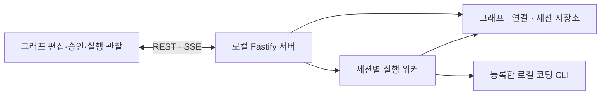

# Agent Graph Studio 구현 계획 및 인수 기준

단독 웹 앱으로 재설계할 때 확정한 설계와 인수 기준이다(기준 `1fc80c8`). 지금 상태와 남은 작업은 [작업 현황](STATUS.md)을 따른다.

재설계의 중심은 그래프 작성·검증·실행·관찰이다. 단독 실행은 Node.js 서버와 로컬 브라우저로 구성하고, VS Code/VSIX와 레거시 호환 경로를 제거한다. Electron 패키징은 이번 범위에 포함하지 않는다.

## 확정한 설계

| 영역 | 결정 |
|---|---|
| 실행 형태 | Node.js 24 이상 + Fastify 서버, React/Vite/React Flow UI, 127.0.0.1:4317 |
| 사용자 흐름 | 그래프 라이브러리 → 역할/연결 편집 → 목표/프로젝트 지정 → 실행 → 방문별 결과와 계획 승인 |
| 그래프 | 계획·구현·테스트·검토·승인·중단 6종 실행 유형, 사용자 역할명/지침, 성공/실패 분기와 순환 |
| 모델 | 직접 등록한 Codex/Claude/OpenCode/Kilo의 CLI 모델 API만 조회; 공통 지정과 노드별 재정의 |
| 보조 설정 | CLI의 인증·MCP·웹·스킬·훅·플러그인 설정을 계승; 앱 내 관리와 설정 주입 제거 |
| 실행 단위 | 세션별 워커; 노드 재방문은 새 visit, 재시도/승인 대기/재개는 같은 visit |
| 승인 | 세션·노드·visit·문서 revision·요청 ID로 식별; 이전 방문이나 수정 전 문서 승인은 거부 |
| 저장 | 새 graph-workspace 영역; 그래프 version 2, 연결 version 1, 실행 stateVersion 3 |
| 안전장치 | 고정 목표/REQ 원문, 읽기 역할 제한, 완료/판정 증거, watchdog, 복구·반복 예산, owner/lease |
| 수명 | 브라우저 종료 중 실행 유지; 서버 정상 종료는 관리 중 실행과 예약 복구 중지; crash는 비용 관측에 따라 수동/자동 복구 구분 |
| 초안 | 500ms 자동 저장, revision CAS와 파일 잠금/원자 쓰기, 충돌 초안 보존 및 새 그래프로 저장 |
| 배포 | npm CLI와 웹 자산을 함께 배포; 테스트·VSIX·세션 데이터는 패키지에서 제외 |

병렬 실행·합류·범용 데이터 흐름, 클라우드 서비스, 레거시 설정/세션 자동 변환은 후속 범위로 둔다. 기존 사용자 실행 데이터는 변환하거나 지우지 않는다.

## 구현과 인수 기준

| ID | 목표 | 완료 증거 |
|---|---|---|
| APP-01 | Node 24, Fastify, React/Vite/React Flow 기반 로컬 웹 앱 | 빌드, 패키지 실행, 브라우저 검증 |
| APP-02 | localhost 제한, 세션 쿠키, Origin/Host 검증 | API 보안 테스트 |
| APP-03 | npm start / agent-loop ui, root/port/no-open 옵션 | CLI 및 설치된 패키지 smoke |
| GRAPH-01 | 그래프 생성·복제·수정·삭제·가져오기·내보내기 | API와 브라우저 시나리오 |
| GRAPH-02 | 노드 추가·이동·삭제, 성공/실패 연결, 줌·화면맞춤, undo/redo | 브라우저 시나리오와 스크린샷 |
| GRAPH-03 | 역할 이름·지침, 6종 실행 유형, 공통/노드별 모델 설정 | 모델 바인딩 테스트 |
| GRAPH-04 | 초안 자동 저장, revision 충돌, 로컬 초안 복원 | 충돌·재접속 테스트 |
| GRAPH-05 | 구조 검증과 실행 검증 분리, 순환/종료 경로 검사 | 컴파일러 테스트 |
| RUN-01 | 세션별 워커, 노드·방문·attempt 분리, 순환 재실행 | 가짜 CLI 통합 테스트 |
| RUN-02 | 방문별 산출물 및 계획 승인, 오래된 승인 거부 | 복수 계획·재방문 테스트 |
| RUN-03 | 실행 snapshot 고정, 편집 화면과 실행 상태 분리 | 실행 중 편집 테스트 |
| RUN-04 | 계획 문서 앱 내 미리보기·수정·승인 | 브라우저 시나리오 |
| RUN-05 | Stop/Interrupt/Resume, owner/lease, timeout, 재시도·복구 예산 | 실행 기반 및 통합 테스트 |
| RUN-06 | 브라우저 종료와 재연결, 서버 종료 및 재시작 | 브라우저·프로세스 수명 테스트 |
| MODEL-01 | 수동 등록한 Codex/Claude/OpenCode/Kilo만 조회 | 4종 모델 API 테스트 |
| MODEL-02 | 조회 결과만 선택, 대체 목록·수동 ID·자동 모델 변경 제거 | 실행 사전 검사 테스트 |
| MODEL-03 | 조회/실행 동일 binary/cwd, 프로젝트별 캐시 | 어댑터 테스트 |
| MODEL-04 | 조회 무추론·무작업 프롬프트, 취소/실패 프로세스 정리 | 프로토콜 및 SDK 검증 |
| MODEL-05 | 실행 전 재조회, 인증/모델 실패 WAITING_USER | 통합 테스트 |
| TOOL-01 | MCP/웹/스킬/훅은 CLI 설정 계승, pure/도구 설정 주입 제거 | 실행 인자 검사 |
| TOOL-02 | 검색 설정 사전 검사 제거, 실제 증거로 판정 | 완료 계약 테스트 |
| TOOL-03 | 파일 변경·검색·토큰 증거는 로그 압축과 독립 | 이벤트 폭주 회귀 테스트 |
| UI-01 | 정상/좁은 화면 레이아웃, 작동하는 버튼·입력·피드백 | Playwright + 직접 GUI 확인 |
| RELEASE-01 | 레거시 삭제, 새 저장 영역, 문서·CI·npm 패키지 갱신 | 패키지 내용 및 회귀 검사 |

구현 순서: 공통 형식/저장/노드 런타임 → 서버/워커 → GUI → 서비스 연동 → 레거시/배포 정리.
검증에서 발견한 문제는 VERIFICATION.md에 원인·수정·재검증 증거를 기록한다. 위 목표를 모두 직접 검증하기 전 완료로 판정하지 않는다.
